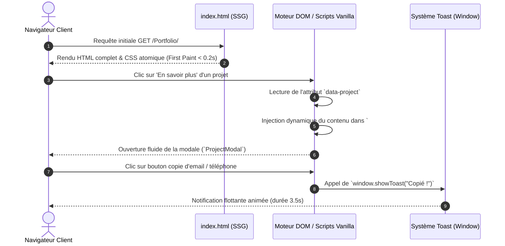
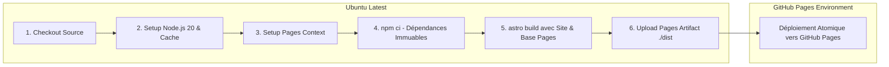

# 🛠️ Documentation Technique — Architecture & Spécifications

Ce document constitue la référence technique officielle de l'architecture logicielle, de la configuration et des mécanismes internes du site portfolio de **Bradley Djedje**.

---

## 📑 Table des Matières

1. [Vue d'Ensemble & Objectifs Techniques](#1-vue-densemble--objectifs-techniques)
2. [Stack Technologique & Dépendances](#2-stack-technologique--dépendances)
3. [Arborescence Détaillée & Rôles des Fichiers](#3-arborescence-détaillée--rôles-des-fichiers)
4. [Architecture Logicielle & Flux de Données](#4-architecture-logicielle--flux-de-données)
5. [Mécanismes Interactifs Client (Vanilla TS / DOM)](#5-mécanismes-interactifs-client-vanilla-ts--dom)
6. [Design System & Moteur de Styles (Tailwind CSS v4)](#6-design-system--moteur-de-styles-tailwind-css-v4)
7. [Pipeline de Build, Compilation & Configuration](#7-pipeline-de-build-compilation--configuration)
8. [Intégration & Déploiement Continus (CI/CD)](#8-intégration--déploiement-continus-cicd)
9. [Performance, Accessibilité (a11y) & Bonnes Pratiques](#9-performance-accessibilité-a11y--bonnes-pratiques)
10. [Guide de Maintenance & Règles de Contribution](#10-guide-de-maintenance--règles-de-contribution)

---

## 1. Vue d'Ensemble & Objectifs Techniques

Le site portfolio est un projet web statique moderne conçu avec **Astro 5** et **Tailwind CSS v4**.

### Objectifs d'Ingénierie
* **Zero-JS Runtime par défaut :** Architecture en îles (*Islands Architecture*) limitant le JavaScript exécuté côté navigateur au strict nécessaire pour les micro-interactions.
* **Score Lighthouse 100/100 :** Pré-rendu HTML complet (SSG), polices optimisées avec `preconnect`, images compressées et CSS compilé de manière atomique.
* **Typage Strict :** Intégration de TypeScript (`strict: true`) pour fiabiliser la manipulation des données et la maintenance des composants.
* **Expérience Utilisateur Moderne :** Thème sombre immersif (*Dark Mode*), effets de verre (*Glassmorphism*), diffuseurs lumineux d'ambiance (*Ambient Glow*) et retours visuels instantanés (système global de *Toasts*).

```mermaid
graph TD
    A[Astro Compiler v5] -->|Parse & Optimize| B[Vite Engine]
    C[Tailwind CSS v4 Engine] -->|@tailwindcss/vite| B
    D[TypeScript Strict Engine] -->|Static Check| B
    B -->|SSG Build| E[Static HTML / CSS / Assets]
    E -->|Artifact Upload| F[GitHub Pages]
```

---

## 2. Stack Technologique & Dépendances

### Dépendances Applicatives (`package.json`)

| Package | Version | Rôle & Justification |
| :--- | :--- | :--- |
| [`astro`](https://astro.build/) | `^5.4.1` | Moteur SSG hybride ultra-performant avec compilation statique des composants `.astro`. |
| [`tailwindcss`](https://tailwindcss.com/) | `^4.0.9` | Framework CSS utilitaire moderne de 4ème génération, ultra-rapide. |
| [`@tailwindcss/vite`](https://tailwindcss.com/docs/installation/vite) | `^4.0.9` | Plugin officiel Vite permettant la compilation directe et native de Tailwind v4. |
| [`@types/estree`](https://www.npmjs.com/package/@types/estree) | `^1.0.9` | Typage strict de l'arbre syntaxique abstrait pour le pipeline de build. |

### Règle d'Overrides & Hygiène des Dépendances
Le manifeste `package.json` verrouille explicitement les versions critiques via la section `overrides` :
```json
"overrides": {
  "esbuild": "^0.28.1",
  "sharp": "^0.35.5",
  "undici": "^7.30.1"
}
```
* **`esbuild` :** Résolution des vulnérabilités connues et optimisation de la vitesse de bundling.
* **`sharp` :** Moteur natif de traitement d'images haute performance.
* **`undici` :** Client HTTP Node.js sécurisé contre les failles d'injection d'en-têtes et SSRF.

---

## 3. Arborescence Détaillée & Rôles des Fichiers

```
site portfolio/
├── .github/
│   └── workflows/
│       └── deploy.yml          # Définition du pipeline GitHub Actions (Build & Déploiement Pages)
├── src/
│   ├── components/             # Composants modulaires d'interface (.astro)
│   │   ├── About.astro         # Présentation, valeurs et méthodologie logicielle
│   │   ├── Certifications.astro# Liste des accréditations officielles
│   │   ├── Contact.astro       # Coordonnées, formulaire préformaté et boutons de copie
│   │   ├── Footer.astro        # Pied de page légal et crédits
│   │   ├── Header.astro        # En-tête sticky avec blur et menu burger mobile
│   │   ├── Hero.astro          # Accroche principale, console de code interactive et CTA
│   │   ├── ProjectModal.astro  # Modale dynamique de détails de projets
│   │   ├── Projects.astro      # Grille des réalisations avec tags et déclencheurs de modale
│   │   ├── Skills.astro        # Matrice 360° des compétences techniques et dev
│   │   └── Timeline.astro      # Parcours chronologique avec filtrage par onglets
│   ├── layouts/
│   │   └── Layout.astro        # Squelette HTML global, métadonnées, fonts et système de toast
│   ├── pages/
│   │   └── index.astro         # Point d'entrée de la Single Page Application statique
│   ├── styles/
│   │   └── global.css          # Import Tailwind v4, variables CSS de thème et classes utilitaires
│   └── env.d.ts                # Références de types globales Astro Client
├── .gitignore                  # Exclusion des artefacts dist, node_modules et caches
├── .npmrc                      # Configuration npm locale
├── AGENTS.md                   # Règles opérationnelles de l'agent (maintenance du README)
├── README.md                   # Présentation générale du projet et vitrine publique
├── USER_GUIDE.md               # Guide utilisateur complet (navigation et mise à jour)
├── TECHNICAL_DOCUMENTATION.md  # Ce document technique
├── astro.config.mjs            # Configuration d'Astro (site, base, plugins Vite)
├── package.json                # Dépendances, scripts npm et overrides de sécurité
├── package-lock.json           # Arbre immuable des dépendances installées
└── tsconfig.json               # Configuration TypeScript en mode strict
```

---

## 4. Architecture Logicielle & Flux de Données

Le projet adopte une architecture **Single-Page Application Statique (SSG)** orchestrée autour de `Layout.astro` et `index.astro`.

### Décomposition du Rendu



### Rôle du Layout Global (`src/layouts/Layout.astro`)
1. **Injection des métadonnées SEO & OpenGraph** : Centralisation du titre, de la description, des mots-clés et des balises sociales.
2. **Chargement des polices Google Fonts** : Pré-connexion sécurisée (`dns-prefetch` / `preconnect`) pour *Plus Jakarta Sans* et *Space Grotesk*.
3. **Conteneur d'ambiance (*Glow Backdrop*)** : Orbes lumineux en arrière-plan floutés à 120px, isolés de tout événement pointeur (`pointer-events-none`).
4. **API Globale Toast** : Déclaration de `window.showToast(message: string)` injectant des éléments éphémères dans `#toast-container`.

---

## 5. Mécanismes Interactifs Client (Vanilla TS / DOM)

Afin d'éviter la surcharge d'un framework JS lourd (React, Vue), tous les comportements interactifs reposent sur des scripts client légers et hautement performants.

### 5.1. Système de Modale Dynamique (`ProjectModal.astro`)
* **Stockage des données :** Registre typé `Record<string, ProjectDetail>` contenant la description, les missions clés, la stack et les livrables de chaque projet.
* **Ouverture :** Détecteurs d'événements `click` sur les boutons portant l'attribut `[data-project]`.
* **Rendu :** Injection par template string dans `#modal-content` avec sanitisation des classes CSS.
* **Fermeture ergonomique :**
  - Clic sur le bouton de fermeture (`#close-modal-btn`).
  - Clic sur l'arrière-plan semi-transparent (*backdrop click*).
  - Pression de la touche clavier <kbd>Échap</kbd> (`Escape`).
* **Gestion du défilement :** Blocage du scroll du document (`document.body.style.overflow = "hidden"`) pendant l'affichage.

### 5.2. Filtrage Dynamique de la Chronologie (`Timeline.astro`)
* **Déclencheur :** Boutons `.timeline-filter-btn` munis d'un attribut `data-filter` (`all`, `experience`, `formation`).
* **Algorithme de masquage :**
  ```typescript
  const filter = btn.getAttribute('data-filter');
  items.forEach((item: HTMLElement) => {
    const itemType = item.getAttribute('data-type');
    item.style.display = (filter === 'all' || itemType === filter) ? 'block' : 'none';
  });
  ```
* **Performance :** Filtrage instantané par manipulation directe du style de display sans refonte de l'arbre DOM.

### 5.3. Presse-papier & Retours Haptiques (`Contact.astro` & `Hero.astro`)
* **API Native :** Utilisation de `navigator.clipboard.writeText(value)`.
* **Tolérance aux pannes :** Fallback visuel et capture d'erreurs en cas de restrictions de permissions sur le navigateur.
* **Feedback visuel combiné :**
  - Notification toast globale via `window.showToast()`.
  - Modification temporaire de l'icône du bouton déclencheur pendant 2 secondes.

### 5.4. Menu Mobile Réactif & En-Tête Sticky (`Header.astro`)
* **Comportement Sticky :** Positionnement fixe avec flou d'arrière-plan en CSS pur (`backdrop-blur-md`).
* **Bouton Burger :** Bascule de la classe `hidden` sur le volet déroulant mobile `#mobile-menu`.
* **Fermeture automatique :** Tout clic sur un lien d'ancrage mobile replie automatiquement le menu.

---

## 6. Design System & Moteur de Styles (Tailwind CSS v4)

Le projet tire parti des capacités de **Tailwind CSS v4** sans fichier de configuration legacy `tailwind.config.js`.

### Fichier Source : `src/styles/global.css`

```css
@import "tailwindcss";

@layer base {
  :root {
    --bg-primary: #0a0d14;
    --bg-secondary: #101522;
    --text-primary: #f8fafc;
    --text-secondary: #94a3b8;
  }

  html {
    scroll-behavior: smooth;
    scroll-padding-top: 80px;
  }
}
```

### Classes Utilitaires Personnalisées

1. **`.glass-card` :**
   - Fond semi-transparent : `rgba(18, 24, 38, 0.7)`.
   - Flou d'arrière-plan : `backdrop-filter: blur(16px)`.
   - Bordure subtile : `1px solid rgba(255, 255, 255, 0.08)`.
   - Hover : Transition douce vers une lueur cyan (`rgba(6, 182, 212, 0.4)`).
2. **`.glow-orb` :**
   - Diffuseurs radiaux avec filtre de flou gaussien `blur(120px)`.
3. **`.gradient-text` :**
   - Dégradé linéaire cyan-bleu-violet avec masquage de texte (`-webkit-background-clip: text`).

---

## 7. Pipeline de Build, Compilation & Configuration

### Fichier `astro.config.mjs`
```javascript
import { defineConfig } from 'astro/config';
import tailwindcss from '@tailwindcss/vite';

export default defineConfig({
  site: 'https://herdofpane.github.io',
  base: '/Portfolio',
  devToolbar: {
    enabled: false,
  },
  vite: {
    plugins: [tailwindcss()],
  },
});
```
* **`site` & `base` :** Configuration indispensable pour la résolution correcte des assets statiques et liens sous GitHub Pages (`/Portfolio/`).
* **`devToolbar.enabled = false` :** Désactivation de la barre d'outils de dev Astro pour garantir une vue de test épurée.
* **`vite.plugins` :** Intégration du compilateur JIT Tailwind v4 au sein du cycle de vie de Vite.

### Fichier `tsconfig.json`
```json
{
  "extends": "astro/tsconfigs/strict",
  "compilerOptions": {
    "types": []
  },
  "include": [".astro/types.d.ts", "**/*"],
  "exclude": ["dist", "node_modules"]
}
```
L'héritage de `astro/tsconfigs/strict` force un contrôle strict des types (interdiction de `any` implicite, contrôle rigoureux des valeurs `null` et `undefined`).

---

## 8. Intégration & Déploiement Continus (CI/CD)

Le workflow GitHub Actions `.github/workflows/deploy.yml` est déclenché à chaque `push` sur la branche `main`.

### Architecture du Pipeline



### Points Clés du Workflow
* **Gestion de la concurrence :** `concurrency: group: "pages", cancel-in-progress: false` pour éviter d'interrompre un déploiement en cours.
* **Sécurité des permissions :**
  ```yaml
  permissions:
    contents: read
    pages: write
    id-token: write
  ```
  Principe de moindre privilège avec jetons OpenID Connect (OIDC) pour l'authentification GitHub Pages.
* **Build dynamique des URLs :**
  ```bash
  npx --no-install astro build \
    --site "${{ steps.pages.outputs.origin }}" \
    --base "${{ steps.pages.outputs.base_path }}"
  ```

---

## 9. Performance, Accessibilité (a11y) & Bonnes Pratiques

### Accessibilité (WCAG AA)
* **Balisage sémantique :** Utilisation stricte des balises `<header>`, `<nav>`, `<main>`, `<section>`, `<article>`, `<button>` et `<footer>`.
* **Accessibilité des modales :** Rôles `aria-hidden` mis à jour dynamiquement, touches de raccourci gérées, contraste supérieur à 4.5:1 sur l'ensemble des textes.
* **Cibles tactiles :** Tous les boutons et éléments interactifs respectent une surface minimale de $44 \times 44 \text{ px}$.

### Sécurité & DevSecOps
* **Protection XSS :** Aucune injection directe non contrôlée de contenu externe (`innerHTML` est strictement réservé au registre interne typé de `ProjectModal`).
* **Navigation sécurisée :** Tous les liens externes vers LinkedIn, GitHub ou démonstrations intègrent `rel="noopener noreferrer"`.
* **Zero Secret :** Aucune clé API, token ou identifiant sensible n'est présent dans les sources client.

---

## 10. Guide de Maintenance & Règles de Contribution

### Commandes Utiles de Développement
```bash
# Installation propre et déterministe
npm ci

# Démarrage du serveur local avec rechargement à chaud (Hot Reload)
npm run dev

# Construction statique de production
npm run build

# Prévisualisation locale du dossier de build ./dist
npm run preview
```

### Règles d'Intégrité de la Documentation
Conformément à la règle [AGENTS.md](file:///c:/Users/bradl/Documents/projets/site%20portfolio/AGENTS.md), toute mise à jour affectant :
1. Les compétences ou le profil de Bradley,
2. L'architecture ou les composants de `src/components/`,
3. Les dépendances ou scripts de `package.json`,
4. Le workflow CI/CD `.github/workflows/deploy.yml`,

**doit être immédiatement répercutée dans :**
* Le présent document technique (`TECHNICAL_DOCUMENTATION.md`),
* Le guide utilisateur (`USER_GUIDE.md`),
* Le sommaire public du projet (`README.md`).
